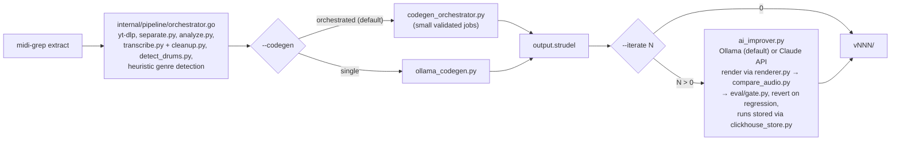

# MIDI-grep

MIDI-grep turns a song (a YouTube link or an audio file) into **editable [Strudel](https://strudel.dygy.app/)
code**. The code is a re-performance: transcribed bass and lead/chord notes, an extracted drum pattern and
per-bar mix data, all written as bar arrays you can change. It is not a recording played back. Each piece is
rendered with the real Strudel engine, scored against the original, and gated against regression floors.

```
YouTube / WAV / MP3
  → stems (Demucs) → tempo, key, genre → MIDI per stem + drum onsets
  → instruments cut from the stems (or palette sounds) → generated Strudel
  → offline render → compare to the original instrumental → calibrate → gate → vNNN/ + report.html
```

The ground rules are in [`context/product/values.md`](context/product/values.md):

- **Editability is the product.** Audio replay (`loopAt`, `slice(N, run(N)).slow(N)`, full-stem or per-bar-loop
  samples) is forbidden. `scripts/python/editability_check.py` rejects it, and `compare_audio.py --strudel`
  refuses to score it.
- **Vocals are never generated.** Every score is computed against `instrumental.wav`, which is bass + drums +
  melodic stems (`pipeline_helpers.py instrumental`).
- **No per-track constants.** Every gain, filter and effect value comes from analysis of the track or from the
  calibration loop.

## Current state

The reference dataset is four brazilian_funk tracks, each built in both modes
([`eval/datasets/reference_tracks.yaml`](eval/datasets/reference_tracks.yaml)). The floors come from
[`eval/thresholds.yaml`](eval/thresholds.yaml) `modes:`. Each floor is the lowest track's score minus 0.02, rounded
to 2 decimals.

| Track | Mode | Run | Overall | Section-aware | Margin over a different song |
|-------|------|-----|---------|---------------|------------------------------|
| Regime CLT (Dj Brunin XM, Aurora Shukita) | sample-instrument | v087 | 0.9093 | 0.9002 | 0.3331 |
| Regime CLT | synth | v088 | 0.9136 | 0.9038 | 0.3374 |
| VAGABUNDO NÃO NAMORA (Christopher Luz) | sample-instrument | v072 | 0.8816 | 0.8588 | 0.3066 |
| VAGABUNDO NÃO NAMORA | synth | v073 | 0.8395 | 0.8058 | 0.2646 |
| Dumb Blond Bitches (Barbit) | sample-instrument | v019 | 0.8700 | 0.8677 | 0.2862 |
| Dumb Blond Bitches | synth | v020 | 0.8094 | 0.7938 | 0.2257 |
| Automotivo XM, Taka Taka Taka Tá (Dj Brunin XM) | sample-instrument | v017 | 0.9000 | 0.8970 | 0.2661 |
| Automotivo XM | synth | v018 | 0.8624 | 0.8412 | 0.2285 |

| Mode | Overall floor | Section-aware floor |
|------|---------------|---------------------|
| sample-instrument (brazilian_funk) | 0.85 | 0.84 |
| synth (brazilian_funk) | 0.79 | 0.77 |

These runs are on the seeded offline renderer, rebuilt on main 2026-10-31. The score scale changed on 2026-10-18 (see
[Scoring](#scoring-and-the-gate)), so any number from before that date is not comparable. Older numbers are
kept as history in the comments of `thresholds.yaml`.

## Architecture

```
                              MIDI-grep: the editable pipeline

   INPUT          SEPARATE         ANALYZE            BUILD                CALIBRATE             OUTPUT
     │                │                │                 │                      │                   │
     ▼                ▼                ▼                 ▼                      ▼                   ▼
┌─────────┐    ┌────────────┐    ┌────────────┐    ┌──────────────┐    ┌──────────────────┐    ┌──────────┐
│ YouTube │    │  Demucs    │    │ librosa    │    │ Basic Pitch  │    │ generate_dynamic │    │ vNNN/    │
│ yt-dlp  │───▶│  stems     │───▶│ BPM / key  │───▶│ MIDI + drums │───▶│ → offline render │───▶│ .strudel │
│ WAV/MP3 │    │ (in-proc.) │    │ CLAP genre │    │ sample pack  │    │ → compare + gate │    │ + report │
└─────────┘    └────────────┘    │ tempo fit  │    │ instruments  │    │ → calibrate      │    └──────────┘
                    │            └────────────┘    └──────────────┘    └──────────────────┘
                    ▼                                     │                      │
              ┌──────────────┐                     ┌──────────────┐    ┌──────────────────┐
              │ melodic      │                     │ R2 (wrangler)│    │ headless Chromium│
              │ bass, drums  │                     │ or localhost │    │ @strudel/web     │
              │ vocals (not  │                     │ :5555        │    │ OfflineAudio-    │
              │ generated)   │                     └──────────────┘    │ Context          │
              └──────────────┘                                         └──────────────────┘
       bass + drums + melodic → instrumental.wav (target)              ClickHouse calibration memory

────────────────────────────────────────────────────────────────────────────────────────────────────
                              Tech Stack

  Go 1.25+                              Python 3.11 (scripts/python/.venv)
  ├── CLI (Cobra): extract, serve,      ├── separate.py           - Demucs stems
  │   generative, report                ├── transcribe.py         - Basic Pitch audio → MIDI
  ├── HTTP (Chi) + HTMX templates       ├── detect_genre_dl.py    - CLAP genre
  └── internal/pipeline orchestrator    ├── generate_dynamic_strudel.py - editable Strudel
                                        ├── compare_audio.py      - static + temporal score
  TypeScript/Node.js (scripts/node)     ├── calibrate_dynamic.py  - knob corrections
  ├── render-strudel-offline.ts         └── calibration_memory.py - ClickHouse memory
  │   (default renderer)
  └── record-strudel-blackhole.ts       Shell drivers
      (cross-check only)                ├── scripts/editable-pipeline.sh (stages 1-10)
                                        └── scripts/auto-calibrate.sh    (stage 7 loop)
```

### Complete Orchestration Flow

`scripts/editable-pipeline.sh` runs stages 1–10. Each stage is skipped when its output exists and is current
(`--force` redoes all). The sample pack, the instrument models and the calibrated BEST renders are stamped with
`calibration_memory.py code-version` (`.pipeline/pack.code`, `models/<name>/.code`, `.pipeline/<mode>/best.code`),
so a code change rebuilds them.

```mermaid
flowchart TB
    %% ===== STAGE 1: stems + analysis =====
    URL["editable-pipeline.sh --url / --title"] --> S1{"stems + metadata.json<br/>in .cache/stems/&lt;track&gt;/?"}
    S1 -->|No| Extract["1: midi-grep extract --render none --iterate 0<br/>yt-dlp → separate.py (Demucs) → analyze.py (librosa)"]
    S1 -->|Yes| S1b
    Extract --> S1b["1b: detect_genre_dl.py (CLAP)<br/>pipeline_helpers.py stamp<br/>tempo_refine.py (phase coherence on drums.wav)"]
    S1b --> Instr["pipeline_helpers.py instrumental<br/>→ instrumental.wav (bass + drums + melodic)"]

    %% ===== STAGES 2-6: material =====
    Instr --> S2["2: transcribe.py (Basic Pitch)<br/>bass.wav, melodic.wav → .mid"]
    S2 --> S3["3: detect_drums_bands.py → drums_bands.json<br/>3b: bass_register.py → bass_f0.json"]
    S3 --> S4["4: build_sample_pack.py<br/>drum one-shots + pitched multisamples"]
    S4 --> S5["5: midi-grep generative train --midi<br/>(one grain per note) + build_instruments.py<br/>→ instruments/samples.json + verification.json"]
    S5 --> S6{"6: host"}
    S6 -->|"--r2 (default)"| R2["upload_r2.py (wrangler)<br/>changed files only"]
    S6 -->|"--local"| Local["CORS server :5555"]

    %% ===== STAGE 7: calibration loop =====
    R2 --> Cal
    Local --> Cal
    Cal["7: auto-calibrate.sh<br/>sample-instrument, then --mode synth"] --> Warm["calibration_memory.py warm-start<br/>(this track or nearest same-genre)"]
    CH[("ClickHouse<br/>.clickhouse/db<br/>midi_grep.calibration_steps")] -.-> Warm
    Warm --> Gen["generate_dynamic_strudel.py"]
    Gen --> Render["renderer.py → render-strudel-offline.js<br/>mix + bass solo + melodic solo<br/>in parallel (render_jobs.py)"]
    Render --> Cmp["compare_audio.py vs instrumental.wav<br/>gate_margin.py"]
    Cmp --> Solo["bass_solo.py / melodic_solo.py<br/>(voice level vs bass.wav / melodic.wav)"]
    Solo --> Step["calibrate_dynamic.py → next knobs<br/>calibrate_loop.py: keep / revert / stop"]
    Step -.->|record step| CH
    Step -->|next iteration| Gen
    Step -->|stop| Post["after BEST: bass-shape trial,<br/>synth lead fit (lead_synth.py),<br/>loudness (mix_dynamics.py),<br/>master bus (only if the engine has one)"]

    %% ===== STAGES 8-10 =====
    Post --> S8["8: compare_audio.py --strudel --control &lt;other track&gt;<br/>eval/gate.py --mode, editability_check.py"]
    S8 --> S9["9: pipeline_helpers.py promote → vNNN/<br/>calibration_memory.py record-promoted"]
    S9 --> S10["10: pipeline_helpers.py report<br/>report.html, charts, render stems,<br/>stem_comparison.json, iterations.json"]
    S9 -.-> CH

    style Extract fill:#2e7d32,color:#fff
    style S1b fill:#7b1fa2,color:#fff
    style Cal fill:#e65100,color:#fff
    style Render fill:#512da8,color:#fff
    style Cmp fill:#00796b,color:#fff
    style S8 fill:#00796b,color:#fff
    style CH fill:#303f9f,color:#fff
    style S10 fill:#1b5e20,color:#fff
```



**The `midi-grep extract` path** (the original one-shot CLI; the editable pipeline uses it only for stage 1):



`extract --render` without `--iterate` uses older paths in `cmd/midi-grep/main.go`: the BlackHole recorder with
`--blackhole`, otherwise `render_with_models.py`, `iterative_render.py` or `render_audio.py`.

**Renderer.** `scripts/python/renderer.py` is the one switch (`MIDIGREP_RENDERER`, default `offline`). The offline
renderer `scripts/node/src/render-strudel-offline.ts` runs Strudel's own `renderPatternAudio` on an
`OfflineAudioContext` in headless Chromium (puppeteer) with the pinned `@strudel/web` 1.3.0 bundle, in whole-cycle
chunks, each in a fresh page. Supporting modules in `scripts/node/src/`:

- `determinism.ts`: seeded `Math.random` and worklet PRNGs, so two renders differ by at most 1 LSB.
- `sample-cache.ts`: the on-disk sample cache in `.cache/render-samples/`.
- `offline-helpers.ts`: chunk planning, the render checks and the hang-watchdog limit (`stallLimitS`).

`record-strudel-blackhole.ts` (with `capture-rate.ts`, `capture-guard.ts`) records live playback through BlackHole
and is a cross-check only. It has a known pitch defect, described under [Renderer](#renderer).

### External Dependencies

| Component | Technology | Where it is used |
|-----------|------------|------------------|
| **yt-dlp** | Python CLI (in the venv, `requirements.txt`) | `internal/audio/youtube.go`; `MIDIGREP_YTDLP` overrides the binary; `MIDIGREP_YTDLP_COOKIES_FROM_BROWSER` / `MIDIGREP_YTDLP_COOKIES` pass a signed-in session past YouTube's bot check |
| **ffmpeg** | C binary | Audio conversion and mp3 copies for the report; BlackHole capture |
| **Demucs** | PyTorch | `separate.py` (run in-process via `demucs.apply`). Installed by `scripts/install-deps.sh`; not listed in `requirements.txt` |
| **Basic Pitch** | TensorFlow 2.15 + `keras<3` | `transcribe.py` (audio → MIDI) |
| **librosa** | Python | BPM/key (`analyze.py`), onsets, features in `compare_audio.py` |
| **CLAP** | `laion-clap`, falling back to `transformers` `ClapModel` | `detect_genre_dl.py` (stage 1b genre) |
| **openl3** | Python | Timbre embeddings for `scripts/python/rave/` |
| **pyyaml, pydantic, fastmcp** | Python | `eval/gate.py` thresholds, `pipeline_helpers.py` models, the `loop` MCP server |
| **puppeteer + Chromium** | Node.js | Hosts the offline renderer (and the BlackHole recorder) |
| **`@strudel/web` 1.3.0, `@strudel/soundfonts` 1.2.6** | Node.js (pinned in `package.json`) | The real Strudel/superdough engine inside the renderer |
| **ClickHouse local** | C++ binary at `bin/clickhouse` | Calibration memory (`calibration_memory.py`) and the `extract --iterate` run store (`clickhouse_store.py`), data in `.clickhouse/db` |
| **wrangler / Cloudflare R2** | `npx wrangler` (or the `aws` CLI with R2 keys) | `upload_r2.py`, stage 6 hosting of the sample pack |
| **Ollama / Claude API** | Local LLM / HTTP API | Only for `extract` codegen and `--iterate` |
| **BlackHole** | macOS audio driver | Optional cross-check renderer only |

`detect_genre_essentia.py` exists, but nothing in the pipeline calls it. The stage-1b genre is the owner's label when the track is in `eval/datasets/genre_labels.yaml`, else a kNN of its CLAP embedding against the labelled tracks (`genre_knn.py`), with CLAP zero-shot only as the flagged-uncertain fallback.

### Module Structure

```
midi-grep/
├── cmd/midi-grep/main.go       # Cobra commands: extract, serve, generative (gen, rave), report
│
├── internal/                   # Go packages
│   ├── audio/                  # input validation, yt-dlp download, Demucs wrapper (separate.py)
│   ├── analysis/               # BPM & key (analyze.py)
│   ├── midi/                   # transcription (transcribe.py) + cleanup (cleanup.py)
│   ├── drums/                  # drum detection (detect_drums.py)
│   ├── pipeline/               # extract orchestrator → codegen_orchestrator.py / ollama_codegen.py
│   ├── generative/             # wrapper for scripts/python/rave (granular / RAVE training)
│   ├── report/                 # Go HTML report generator (midi-grep report)
│   ├── server/                 # Chi + HTMX web UI, SSE, background jobs
│   ├── cache/                  # stem + vNNN output caching
│   ├── exec/                   # Python subprocess runner (finds scripts/python/.venv)
│   ├── progress/, workspace/, errors/
│
├── scripts/
│   ├── editable-pipeline.sh    # stages 1-10, one command from a link to editable Strudel
│   ├── auto-calibrate.sh       # stage 7: generate → render → compare → calibrate loop
│   ├── sample-pipeline.sh      # earlier sample-pack driver
│   ├── midi-grep.sh, extract-*.sh, quick-riff.sh, serve.sh, install-deps.sh
│   ├── node/
│   │   ├── src/
│   │   │   ├── render-strudel-offline.ts   # default renderer
│   │   │   ├── determinism.ts, sample-cache.ts, offline-helpers.ts
│   │   │   └── record-strudel-blackhole.ts, capture-rate.ts, capture-guard.ts   # cross-check
│   │   ├── test/               # node --test suites (render, determinism, sample cache, capture)
│   │   └── strudel-validate.mjs
│   └── python/
│       ├── separate.py, analyze.py, tempo_refine.py, transcribe.py, cleanup.py
│       ├── detect_genre_dl.py, detect_drums.py, detect_drums_bands.py, bass_register.py
│       ├── build_sample_pack.py, build_instruments.py, pitched_grains.py, upload_r2.py
│       ├── generate_dynamic_strudel.py, sound_selector.py, lead_synth.py, bass_shape.py
│       ├── renderer.py, render_jobs.py, solo_stems.py
│       ├── compare_audio.py, compare_cache.py, gate_margin.py, editability_check.py
│       ├── calibrate_dynamic.py, calibrate_loop.py, bass_solo.py, melodic_solo.py, mix_dynamics.py
│       ├── calibration_memory.py, clickhouse_store.py
│       ├── pipeline_helpers.py  # stamp, instrumental, control, promote, report, record-floor (a genre floor only once >= 2 owner-labelled tracks of it exist), …
│       ├── generate_report.py
│       ├── codegen_orchestrator.py, ollama_codegen.py, ollama_agent.py, ai_improver.py   # extract path
│       ├── rave/               # granular + RAVE trainer, model repository, timbre embeddings
│       └── tests/              # pytest suites
│
├── eval/                       # gate.py, thresholds.yaml, datasets/reference_tracks.yaml
├── mcp_servers/loop/           # FastMCP: render_strudel, compare_render, verify_strudel, eval_gate
├── clickhouse-init/            # ClickHouse schema SQL (docker-compose.clickhouse.yml)
├── models/                     # trained instruments, one dir per <slug>_{bass,lead}
└── context/                    # AWOS docs
    ├── product/                # product-definition, values, architecture, roadmap, delivery-flow
    └── spec/                   # 001-core-pipeline … 004-second-reference-track
```

### Data Flow

```
1. INPUT
   YouTube URL ──▶ yt-dlp ──▶ .cache/stems/<track>/original.wav
   Local file ───────────────▶ .cache/stems/<track>/original.wav

2. STEMS + ANALYSIS (stage 1, cached per track)
   original.wav ──▶ Demucs ──▶ melodic.wav + bass.wav + drums.wav + vocals.wav
                ──▶ librosa + CLAP + tempo_refine ──▶ metadata.json { bpm, bpm_method, key, genre, duration }
   bass + drums + melodic ──▶ instrumental.wav        (the scoring target; vocals are never generated)

3. MATERIAL (stages 2-6)
   bass.wav, melodic.wav ──▶ Basic Pitch ──▶ sample_pack/bass.mid, melodic.mid
   drums.wav ──▶ detect_drums_bands ──▶ sample_pack/drums_bands.json
   stems + MIDI ──▶ build_sample_pack + generative train ──▶ sample_pack/{drums,bass,melodic}/,
                                                             sample_pack/instruments/samples.json
   sample_pack/ ──▶ R2 or localhost:5555        (Strudel fetches samples.json from there)

4. CALIBRATE (stage 7, workdir .cache/stems/<track>/.pipeline/<mode>/)
   knobs ──▶ generate_dynamic_strudel ──▶ calN.strudel ──▶ offline render ──▶ calN.wav
   calN.wav vs instrumental.wav ──▶ calN.cmp.json ──▶ calibrate_dynamic ──▶ next knobs
   every step ──▶ ClickHouse (.clickhouse/db)
   result ──▶ best.strudel, best.wav, best.cmp.json, best.params, best.code, iters.tsv

5. SCORE, PROMOTE, REPORT (stages 8-10)
   best.strudel ──▶ compare_audio --strudel --control ──▶ comparison.json ──▶ eval/gate.py ──▶ gate.txt
                ──▶ editability_check ──▶ editability.json
   promote ──▶ .cache/stems/<track>/vNNN/
               ├── output.strudel, render.wav, comparison.json, metadata.json, env_correction.json
               └── report.html, comparison.png, chart_*.png, render_{melodic,drums,bass}.wav,
                   stem_comparison.json, iterations.json, iterations/

CACHES (shared across tracks)
   .cache/render-samples/     samples the renderer fetched (sample-cache.ts)
   .cache/compare-features/   reference-side features + control scores (compare_cache.py)
   .clickhouse/db             calibration memory + extract --iterate runs
```

## Requirements

macOS is the reference machine. CI also builds and tests the Go, Node and Python-analysis layers on Linux.

- Go 1.25+ (`go.mod`)
- Python **3.11** in `scripts/python/.venv`. `basic-pitch` needs TensorFlow 2.15 + `keras<3`, which do not
  support Python 3.12+.
- Node + npm for `scripts/node`. Puppeteer's Chromium is used by the renderer.
- `ffmpeg`, `yt-dlp` (`MIDIGREP_YTDLP` overrides the binary path; on "Sign in to confirm you're not a bot" set `MIDIGREP_YTDLP_COOKIES_FROM_BROWSER=chrome`)
- For R2 hosting (the default for the editable pipeline): `npx wrangler login`, or R2 S3 keys (see
  `scripts/python/upload_r2.py`). Use `--local` to serve the pack on `localhost:5555` instead.
- Optional: the ClickHouse local binary at `bin/clickhouse` (calibration memory; `.clickhouse/db`).
- Optional, cross-check only: BlackHole 2ch + a Multi-Output Device (`MIDIGREP_RENDERER=blackhole`).
- Optional, only for the legacy `extract --iterate` LLM loop: Ollama with `midi-grep-strudel-mistral`
  (`ollama create midi-grep-strudel-mistral -f Modelfile.mistral`).

The first run downloads about 1 GB of ML models.

## Setup

```bash
python3.11 -m venv scripts/python/.venv
scripts/python/.venv/bin/pip install -r scripts/python/requirements.txt
go build -o bin/midi-grep ./cmd/midi-grep
cd scripts/node && npm install && npm run build && cd -
(cd scripts/node && npx puppeteer browsers install chrome)   # if the renderer reports Chromium missing
```

`make install-python-deps` does the same with whatever `python3` is on `PATH`. `scripts/install-deps.sh` deletes and
recreates the venv with only a subset of the requirements (numpy, librosa, pretty_midi, soundfile, basic-pitch,
demucs).

## Quick start: the editable pipeline

```bash
scripts/editable-pipeline.sh --url "https://youtu.be/Q4801HzWZfg"            # both modes, hosted on R2
scripts/editable-pipeline.sh --url "<url>" --mode sample-instrument --local   # one mode, local hosting
scripts/editable-pipeline.sh --title "VAGABUNDO NÃO NAMORA" --iters 4        # resume an extracted track
scripts/editable-pipeline.sh --help
```

Each stage is skipped when its output already exists and is current. `--force` redoes every stage. Outputs are
also rebuilt when the code that produced them changes: the sample pack, the instruments and the calibrated renders
are stamped with `calibration_memory.py code-version`. Progress goes to stderr. stdout carries only a final JSON
summary.

| Stage | What runs |
|-------|-----------|
| 1 | `midi-grep extract --render none --iterate 0`: stems, BPM/key. 1b: genre (`--genre` > owner labels in `eval/datasets/genre_labels.yaml` > kNN of the CLAP embedding against the labelled tracks > CLAP zero-shot, flagged uncertain when kNN finds no supporting genre) + metadata stamp, tempo refined by phase coherence on the drums stem (`tempo_refine.py`) |
| 2 | `transcribe.py` on `bass.wav` and `melodic.wav` (Basic Pitch). Vocals are not transcribed |
| 3 | `detect_drums_bands.py` drum onsets; 3b: bass f0/register |
| 4 | `build_sample_pack.py`: drum one-shots cut from the detected hits, pitched multisamples |
| 5 | `midi-grep generative train` (one grain per transcribed note) + `build_instruments.py`. Every sample is re-measured for pitch (`instruments/verification.json`) |
| 6 | Host the pack: `upload_r2.py` (`--r2`, default) or a local CORS server (`--local`) |
| 7 | `auto-calibrate.sh` for sample-instrument, then `--mode synth`, which starts from the sample-instrument knobs |
| 8 | `compare_audio.py --strudel --control <other track>`, `eval/gate.py --mode`, `editability_check.py` |
| 9 | `pipeline_helpers.py promote` → `.cache/stems/<track>/vNNN/` |
| 10 | `pipeline_helpers.py report`: `report.html`, charts, render stems, `stem_comparison.json`, `iterations.json`. A missing or failed report is an error |

### Modes

- **sample-instrument** plays pitched instruments cut from the track's own bass and melodic stems, one grain per
  transcribed note, together with the extracted drum kit. Notes stay editable (`note(...)` bar arrays). Only the
  sound source comes from the track.
- **synth** emits no `samples()` call at all. Bass, lead and drums come from the genre palette in
  `sound_selector.py`. A synth-only lead fit (`lead_synth.py`) can replace the palette lead with a fitted
  oscillator. The fit is kept only when it scores better.

The generator for both modes is `scripts/python/generate_dynamic_strudel.py`. It writes a `// generation_mode:`
header and validates its own output.

## Scoring and the gate

`scripts/python/compare_audio.py` compares a render to the original instrumental:

- `static_similarity` is time-averaged: frequency balance 40% (MAE per band, penalty when any band is more than
  15% off), MFCC 20%, energy 15%, brightness 15%, tempo 5%, chroma 5%.
- `temporal_similarity` is time-aligned. The render is aligned within one bar by onset-envelope
  cross-correlation. Then the mean of frame-wise chroma correlation, log-mel correlation, onset F1 (±50 ms) and
  RMS-envelope correlation.
- `overall_similarity = 0.5 × static + 0.5 × temporal`. `section_aware_similarity` applies the same 50/50 split
  per window.
- `--control <another same-genre original>` scores a different song against the same original and gives
  `margin_over_chance`. The time-averaged score alone could not tell the right song from a different one.

`eval/gate.py <comparison.json> --genre <g> --mode <m>` passes when all of these hold:

- overall ≥ the mode floor
- section-aware ≥ the mode section floor
- `margin_over_chance` ≥ `min_margin_over_chance` (0.02)
- no band is off by more than `max_worst_band_diff` (0.30)

Genres without a mode entry fall back to the genre-wide tables, which are on the old static scale.
`scripts/python/tests/test_similarity_gate.py` asserts the reference tracks against the floors. Comparisons that
are missing locally are skipped. Floors are only raised.

The reference side of a compare (the original's features and the control's score) is cached in
`.cache/compare-features/` (`compare_cache.py`, keyed on file content, analysis parameters and code version). A warm
compare skips that work.

## Calibration (`scripts/auto-calibrate.sh`)

The loop runs generate → render → compare → `calibrate_dynamic.py` → repeat. Each knob step is a damped,
bounded correction of a measured ratio. `calibrate_loop.py` handles loop control: a step that is worse than the
best beyond `calibration_noise` (0.005) is reverted. BEST prefers a gate-passing run, then the largest minimum margin to the gate
floors. The loop stops after a set number of steps without improvement, or at `--iters`.

Each iteration also renders some voice groups on their own:

- **Bass solo** (`bass_solo.py`) sets the bass level from the bass voice alone against `bass.wav`, not from mix
  shares that the kick also fills.
- **Melodic solo** (`melodic_solo.py`, sample-instrument only) sets lead level and low-pass from LEAD+CHORDS
  against `melodic.wav`.
- The mix and solo renders of one iteration run in parallel. `render_jobs.py` sizes the number of jobs from CPU
  cores and free memory.

Trials and stages after the loop picks BEST:

- **Bass-shape trial** (`--bass-shape stem|off`) is recorded per track and code version.
- **Synth lead fit** runs in synth mode only.
- **Loudness stage** (`mix_dynamics.py`): the score is level-invariant, so `--master-gain` is moved onto the
  instrumental's RMS. The result is kept only if level and crest match and the score holds.
- **Master-bus stage** runs only when the engine bundle defines `setMasterLimiter` / `setMasterCompressor`
  (`renderer.py master-bus`; npm `@strudel/web` 1.3.0 does not).

The calibration memory lives in ClickHouse (`calibration_memory.py`, table `midi_grep.calibration_steps`). It
supplies warm starts from this track or the nearest same-genre track, learned step sizes, and records of every
step, BEST and promoted version. `--no-memory` or `AC_MEM=off` turns it off. A memory failure never stops a run.

Switches: `--no-mix-dynamics`, `--no-shape-trial`, `--no-lead-fit`, `AC_BSOLO=off`, `AC_MSOLO=off`.

## Renderer

The default is `scripts/node/src/render-strudel-offline.ts`. It runs Strudel's own `renderPatternAudio` on an
`OfflineAudioContext` (pinned `@strudel/web` 1.3.0 + `@strudel/soundfonts` 1.2.6, headless Chromium). That is the
real superdough engine, not an emulation.

```bash
node scripts/node/dist/render-strudel-offline.js piece.strudel -o out.wav -d 150
```

- **Chunked rendering.** The piece renders in whole-cycle chunks, each in a fresh page. A discarded pre-roll
  carries ringing tails, `cut` chokes and ducking across chunk boundaries. Polyphony is 4096.
- **Deterministic** (`determinism.ts`). It seeds `Math.random` and the worklet PRNGs, waits for the reverb IR, and
  schedules ducking on the AudioParam timeline. Two renders differ by at most 1 LSB.
- **Local sample cache** (`sample-cache.ts`, `.cache/render-samples/`). It revalidates entries with conditional
  GETs after a TTL and serves the cached copy when the upstream cannot be reached.
- **Hang watchdog.** A page call that makes no progress for longer than its audio length predicts is killed and
  retried.
- **Fails loudly.** An unloaded sound, silence, a frame or onset count mismatch, or a truncated tail fails the
  render. The WAV is written only after every check passes.

`scripts/python/renderer.py` is the one switch (`MIDIGREP_RENDERER=offline|blackhole`). The shell drivers, the
Python tools and the `loop` MCP server all go through it.

The BlackHole recorder (`record-strudel-blackhole.ts`) records live playback from `strudel.dygy.app/embed` and is
kept as a cross-check only. **Known defect:** its raw capture loses about 12% of the samples, and the rate
correction lowers every pitch by about 2.3–2.7 semitones. It needs BlackHole + a selected Multi-Output Device and
renders one job at a time.

## Outputs

```
.cache/stems/<track>/
├── original.wav, instrumental.wav, melodic.wav, bass.wav, drums.wav, vocals.wav, metadata.json
├── sample_pack/            # MIDI, drum bands, one-shots, pitched samples, instruments/samples.json + verification.json
├── .pipeline/              # per-mode calibration workdirs (best.strudel, best.wav, best.cmp.json, iters.tsv, gate.txt, result.json)
└── vNNN/                   # one promoted piece
    ├── output.strudel      # the editable code
    ├── render.wav, comparison.json, metadata.json, env_correction.json
    └── report.html, comparison.png, chart_*.png, render_{melodic,drums,bass}.wav (mp3 copies for the report in embed/), stem_comparison.json, iterations.json
```

The report stems come from the renderer with one voice group sounding (`solo_stems.py`). Use
`--render-stems demucs` to run Demucs on the render instead. `--no-iteration-stems` skips Demucs on each
calibration iteration. The report embeds mp3 copies of the audio.

## Environment variables

| Variable | Read by | Effect |
|----------|---------|--------|
| `MIDIGREP_RENDERER` | `renderer.py` | `offline` (default) or `blackhole` |
| `MIDIGREP_STRUDEL_BUNDLE` | `renderer.py`, offline renderer | Path to another `@strudel/web` `dist/index.js` |
| `MIDIGREP_RENDER_JOBS` | `render_jobs.py` | Concurrent renders (overrides the derivation; invalid = error) |
| `MIDIGREP_RENDER_RSS_MB`, `MIDIGREP_RENDER_CORES` | `render_jobs.py` | Replace the measured per-render memory / CPU footprint |
| `MIDIGREP_RENDER_SEED` | offline renderer | Seed for deterministic renders (default 1) |
| `MIDIGREP_RENDER_DETERMINISTIC` | offline renderer | `0` = stock, unseeded engine (A/B only) |
| `MIDIGREP_RENDER_SAMPLE_CACHE` | offline renderer | `0` bypasses the sample cache |
| `MIDIGREP_RENDER_SAMPLE_CACHE_DIR` | offline renderer | Cache location (default `.cache/render-samples`) |
| `MIDIGREP_RENDER_SAMPLE_CACHE_TTL_S` | `sample-cache.ts` | Seconds before revalidation (default 600) |
| `MIDIGREP_RENDER_STALL_S` | offline renderer | Overrides the derived hang-watchdog limit |
| `MIDIGREP_RENDER_NET_WAIT_S` | offline renderer | Total seconds to wait out a network outage (default 1800, `0` = never) |
| `MIDIGREP_RENDER_TEST_HANG` | offline renderer | Test seam: `chunk:N` hangs chunk N's first attempt |
| `MIDIGREP_CAPTURE` | BlackHole recorder | `wallclock` restores the old capture path |
| `MIDIGREP_COMPARE_CACHE` | `compare_cache.py` | `0` bypasses the compare reference cache |
| `MIDIGREP_COMPARE_CACHE_DIR` | `compare_cache.py` | Cache location (default `.cache/compare-features`) |
| `MIDIGREP_CLICKHOUSE_DB` | `clickhouse_store.py` | ClickHouse data directory (default `.clickhouse/db`) |
| `MIDIGREP_YTDLP` | `internal/audio/youtube.go` | yt-dlp binary path |
| `MIDIGREP_YTDLP_COOKIES_FROM_BROWSER` | `internal/audio/youtube.go` | browser whose cookies every yt-dlp call carries (`chrome`, `firefox`, ...); needed when YouTube asks to confirm you're not a bot |
| `MIDIGREP_YTDLP_COOKIES` | `internal/audio/youtube.go` | Netscape cookies.txt for the same purpose |
| `MIDIGREP_TARGETED_ITER` | `ai_improver.py` | `1` = job-based targeted iteration in the legacy LLM loop |
| `MIDIGREP_TEST_RENDERER` | Node determinism test | Renderer script under test |

`auto-calibrate.sh` also reads `AC_*` variables, mostly test stubs. See the top of the script.

## Other entry points

- **`midi-grep extract`**: the original one-shot path. It runs stem separation and analysis, then LLM Strudel
  codegen (`--codegen orchestrated`, default, or `single`; Ollama by default, `--ollama=false` = Claude API), then
  an optional `--iterate N` LLM improvement loop (`ai_improver.py`, default 20 iterations,
  `--target-similarity 0.99`) gated by `eval/`. The editable pipeline uses it only for stage 1. Run
  `./bin/midi-grep extract --help` for its flags (`--chords`, `--genre`, `--style`, `--drums-only`, `--quality`,
  `--render`, `--blackhole`, …).
- **`midi-grep generative`** (`gen`, `rave`): `train <audio> --mode granular|rave [--midi notes.mid]`, `search`,
  `list`, `process`, `serve --port 5555`.
- **`midi-grep report <cache-dir> [--version N]`**: rebuild an HTML report with the Go generator.
- **`midi-grep serve --port 8080`**: the HTMX web UI. Known defect: its job runner (`internal/server/jobs.go`) still calls
  `ai_code_generator.py`, which was deleted.
- **`scripts/sample-pipeline.sh`**: the earlier sample-pack driver (`--mode loops|instrument|hybrid`). Its
  `loops` output replays per-bar audio and is not a valid deliverable under `values.md`.
- **`loop` MCP server** (`mcp_servers/loop/server.py`, registered in `.mcp.json`): `render_strudel`,
  `compare_render`, `verify_strudel` (editability → render → compare → gate), `eval_gate`.

## Testing

```bash
go test ./...
cd scripts/python && .venv/bin/python -m pytest -q tests test_*.py
cd scripts/node && npm test
```

CI (`.github/workflows/ci.yml`) runs Go build/vet/gofmt/test, the Node build, a lightweight pytest subset and
hook/JSON checks. Renders and anything that needs ML models run locally.

## No longer present

- The Node.js synthesis renderer `render-strudel-node.ts` was deleted in Jun 2026. It was an emulation and read
  about 16% against the real engine. Dead references remain in `cmd/midi-grep/main.go`, `synth_profiles.py` and
  `ai_learning_optimizer.py`.
- The app `Dockerfile` was retired in Oct 2026. Only `docker-compose.clickhouse.yml` remains.
- The vocal voice, its instrument and its calibration knob were removed on 2026-10-19.
- Similarity numbers from before 2026-10-18 are on the old time-averaged scale. Numbers from before the Jun 2026
  recorder tempo fix were measured on sped-up audio.

## Further docs

- [`CLAUDE.md`](CLAUDE.md): working agreement, principles and lessons per component.
- [`llms.txt`](llms.txt) / [`llms-full.txt`](llms-full.txt): overview / detailed script reference.
- [`context/product/architecture.md`](context/product/architecture.md), [`roadmap.md`](context/product/roadmap.md),
  [`values.md`](context/product/values.md); specs under `context/spec/`.

## License

MIT

## Credits

[Demucs](https://github.com/facebookresearch/demucs), [Basic Pitch](https://github.com/spotify/basic-pitch),
[librosa](https://librosa.org/), [Strudel](https://strudel.cc/), [HTMX](https://htmx.org).
